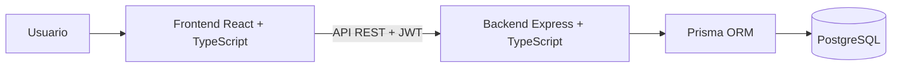

# PlannerOn

Aplicación web de productividad personal para organizar tareas, proyectos, agenda, hábitos, notas, sesiones de enfoque y movimientos financieros.

- **Demo:** https://planneron.vercel.app
- **Repositorio:** https://github.com/ErikSneyPlata/PlannerOn

## Funcionalidades

- Registro, inicio y cierre de sesión.
- Tareas y proyectos con prioridad, estado y fechas.
- Agenda y calendario para organizar eventos.
- Hábitos y registro de seguimiento.
- Notas y documentación asociadas a proyectos.
- Sesiones de enfoque.
- Registro de ingresos y gastos personales.
- Panel de estadísticas y ajustes de usuario.

## Cómo funciona

El frontend en React y TypeScript se comunica con una API REST en Express. El backend valida las solicitudes, autentica usuarios con JWT y utiliza Prisma para leer y guardar datos en PostgreSQL. Las tablas principales están relacionadas con el usuario propietario para mantener organizados sus datos.



## Tecnologías

- **Frontend:** React, TypeScript, Vite, React Router, TanStack Query, Zustand, React Hook Form y Zod.
- **Backend:** Node.js, Express, TypeScript, Prisma, Zod, bcrypt y JWT.
- **Base de datos:** PostgreSQL.
- **Migraciones:** archivos versionados en `backend/prisma/migrations/`.

## Estructura del proyecto

- `frontend/src/pages/`: pantallas principales de la aplicación.
- `frontend/src/lib/api.ts`: cliente para las solicitudes a la API.
- `frontend/src/store/`: estado de autenticación y aplicación.
- `backend/src/modules/`: rutas y controladores organizados por funcionalidad.
- `backend/prisma/schema.prisma`: modelos de datos.
- `backend/prisma/migrations/`: cambios versionados del esquema.

## Requisitos

- Node.js y npm.
- Una base de datos PostgreSQL.
- Variables de entorno para el backend y el frontend.

## Ejecutar localmente

### 1. Configurar e iniciar el backend

Desde la raíz:

```bash
cd backend
npm install
```

Crea `backend/.env`:

```dotenv
PORT=5000
NODE_ENV=development
DATABASE_URL=postgresql://<usuario>:<contraseña>@<host>:5432/<base>?schema=public
DIRECT_URL=postgresql://<usuario>:<contraseña>@<host>:5432/<base>?schema=public
JWT_SECRET=<secreto-largo-y-aleatorio>
```

Aplica las migraciones y genera el cliente de Prisma:

```bash
npx prisma migrate dev
npx prisma generate
```

Inicia la API:

```bash
npm run dev
```

La API usa el puerto `5000` por defecto y ofrece `GET /api/health` como comprobación de disponibilidad.

### 2. Configurar e iniciar el frontend

En otra terminal:

```bash
cd frontend
npm install
```

Crea `frontend/.env.local`:

```dotenv
VITE_API_URL=http://localhost:5000
```

Inicia la interfaz:

```bash
npm run dev
```

Vite muestra en la terminal la dirección local para abrir la aplicación.

## Scripts disponibles

En `backend/`:

- `npm run dev`: inicia el servidor de desarrollo.
- `npm run build`: compila TypeScript.
- `npm start`: inicia la versión compilada.

En `frontend/`:

- `npm run dev`: inicia Vite.
- `npm run build`: verifica TypeScript y genera la aplicación de producción.
- `npm run lint`: ejecuta ESLint.
- `npm run preview`: sirve localmente la compilación.

## Notas de seguridad para desarrollo y despliegue

- Usa un valor fuerte y privado para `JWT_SECRET`. Antes de desplegar, elimina el secreto de respaldo incluido actualmente en el controlador de autenticación y haz que el servidor falle al iniciar si falta la variable.
- `backend/src/seed.ts` contiene una cuenta de demostración fija. Ejecútala solo contra una base local desechable y no reutilices esa cuenta en producción.
- Usa datos ficticios en la demo, especialmente para el módulo financiero.
- No subas archivos `.env` ni credenciales al repositorio.
